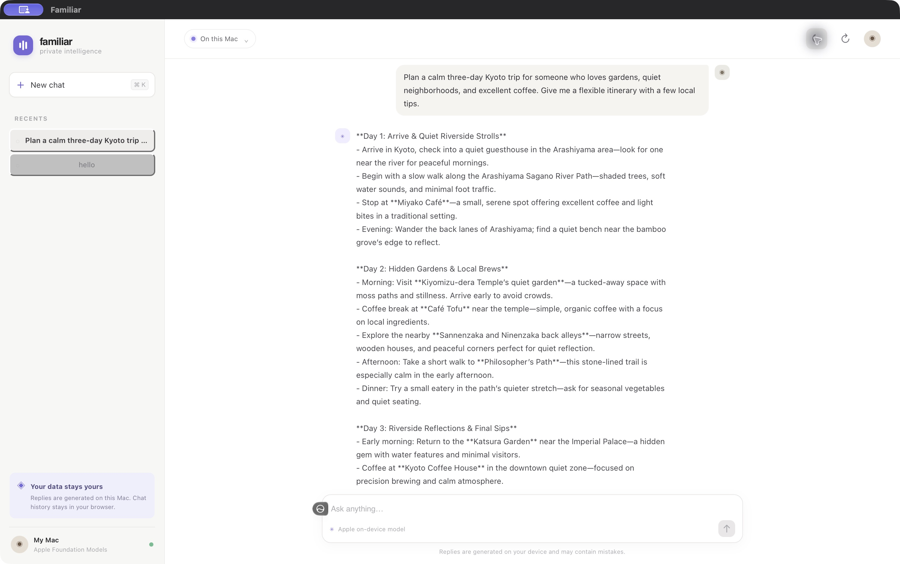
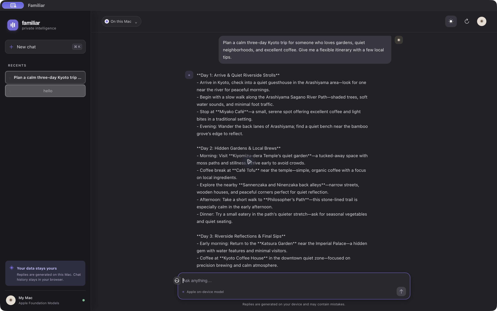

# Familiar Local

A lightweight chat interface for Apple's on-device Foundation Models. Familiar runs on your Mac and keeps the web interface and local server on `127.0.0.1`.

| Light | Dark |
| --- | --- |
|  |  |

## What it does

- Runs prompts through Apple's `SystemLanguageModel` with `LanguageModelSession`
- Keeps separate conversations with their own model context
- Saves chat history in your browser's local storage
- Offers light and dark themes
- Includes an optional macOS app wrapper that starts and stops the local server for you

## Requirements

- A Mac running macOS 26 or later with Swift 6.2+
- Apple Intelligence enabled and its model downloaded and ready
- A supported Mac and prompt language

## Run from source

```sh
swift run apple-fm-chat
```

Open <http://127.0.0.1:8787> in your browser. Stop the server with `Ctrl+C` in Terminal.

## Build the macOS app

```sh
./scripts/package-app.sh
```

This creates `outputs/Familiar.app` and `outputs/Familiar-macOS.zip`. The app bundle is ad-hoc signed for local testing. To distribute it to other people, sign it with a Developer ID certificate and notarize it with Apple.

## Privacy

The server listens only on the loopback address `127.0.0.1`. Prompts are sent to Apple's on-device model; this app does not send them to a hosted AI service. Chat history is stored locally in the browser. Model context lives in server memory and resets when the server stops.

## License

MIT. See [LICENSE](LICENSE).
